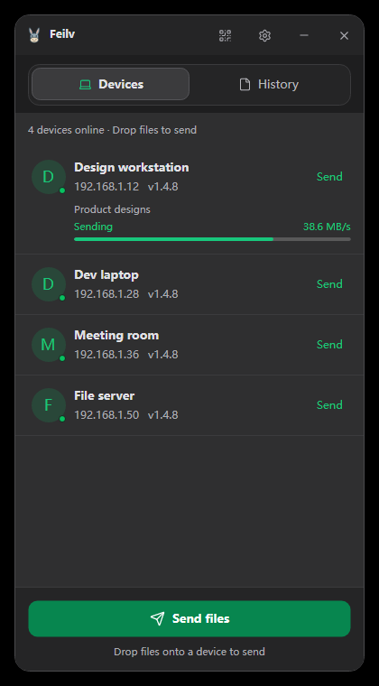
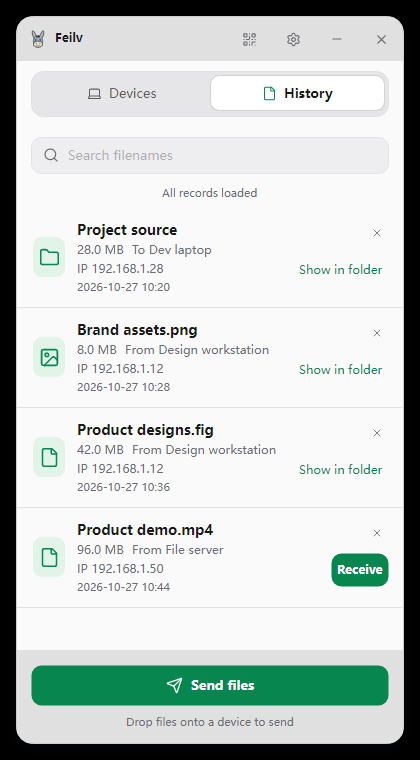
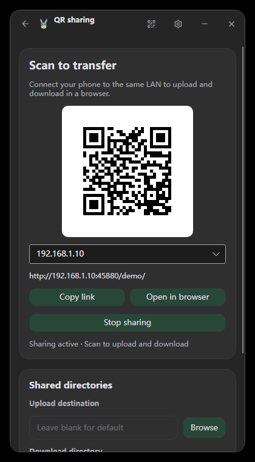
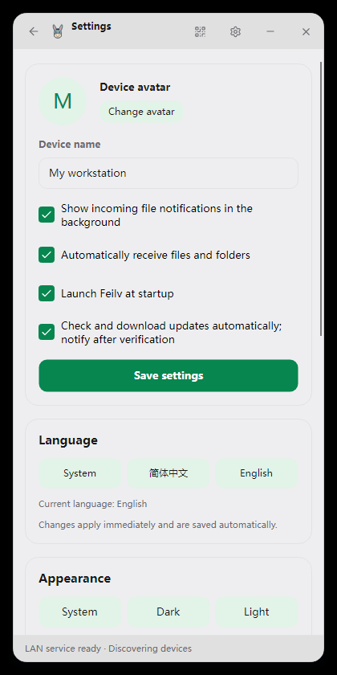
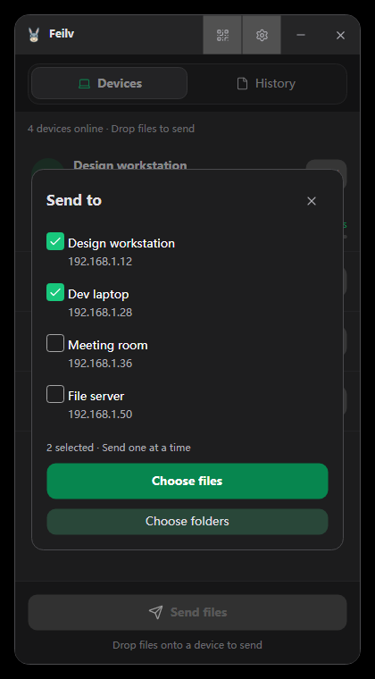
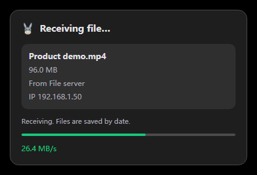
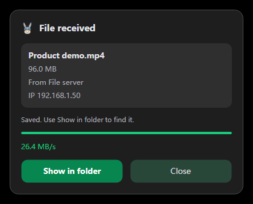

<p align="center">
  
</p>

<h1 align="center">Feilv · 飞驴</h1>

<p align="center"><a href="README.md">简体中文</a> · <strong>English</strong></p>
<p align="center"><strong>Drop a file. Send it across your LAN.</strong></p>
<p align="center">Computer-to-computer transfers · Shared folders · QR sharing with your phone</p>

<p align="center">
  <a href="https://github.com/coolqingcheng/feilv/releases/latest"></a>
  <a href="https://github.com/coolqingcheng/feilv/actions/workflows/release.yml"></a>
  
</p>

<p align="center">
  <a href="https://github.com/coolqingcheng/feilv/releases/latest"><strong>Download Feilv</strong></a> ·
  <a href="#screenshots">Screenshots</a> ·
  <a href="#getting-started">Getting started</a> ·
  <a href="docs/technical-guide.md">Technical guide (Chinese)</a>
</p>

Feilv is a LAN file transfer app built with **C# / Avalonia UI**. It discovers devices on the same local network automatically, with no account or central server required. **Native AOT** packages are available for Windows, macOS and Linux; the destination computer does not need .NET installed.

## Screenshots

| Devices · Dark | History · Light |
| :---: | :---: |
|  |  |

<p align="center"><sub>Actual v1.4.8 interface, populated with demo devices, files and transfers.</sub></p>

<details>
<summary><strong>More: QR sharing, languages, themes, sending and receiving</strong></summary>

| QR sharing · Dark | Language and appearance · Light |
| :---: | :---: |
|  |  |

| Multiple recipients | Automatic reception |
| :---: | :---: |
|  |  |

<p align="center"></p>

</details>

## Features

| Feature | What it does |
| --- | --- |
| Automatic discovery | Shows device name, avatar, IP address and version; updates online status promptly. |
| Drag and drop | Drop files or folders onto a device row, or select multiple files and recipients. Computers are served one at a time. |
| Folder transfers | Sends files and subdirectories recursively, including empty folders, without creating a ZIP. |
| Live progress | Shows progress and speed in the device row. Files are streamed with bounded buffers. |
| Searchable history | Records filename, size, source, IP and time. Scroll for older entries, search by filename, or delete records. |
| Automatic reception | Enabled by default. A corner popup shows progress, speed and completion. Turn it off to receive or decline manually; declines are reported to the sender. |
| Shared folders | Other clients can browse and download files from directories you choose. |
| QR sharing | Upload and download from a phone's browser without installing an app. Upload and download directories can be configured separately. |
| Themes and tray | System, Dark and Light themes; custom device name and avatar; startup option; single-instance operation. |
| Chinese and English | Follows the system language by default. Switch instantly in Settings. The QR webpage has its own language switch. |
| In-app updates | Downloads and verifies updates, shows release notes, then installs and restarts after your confirmation. Local data is kept. |

## Download and install

Open the **[latest stable release](https://github.com/coolqingcheng/feilv/releases/latest)** and choose one package for your system:

| System | Processor | Package |
| --- | --- | --- |
| Windows | x64 | `win-x64-setup.exe`: one installer with English and Chinese wizard languages |
| macOS | Apple Silicon | `osx-arm64.tar.gz` |
| macOS | Intel | `osx-x64.tar.gz` |
| Linux | x64 | `linux-x64.tar.gz` |
| Linux | ARM64 | `linux-arm64.tar.gz` |

All filenames start with `feilv-vVERSION-`. On Windows, run the installer and choose a directory. Installation defaults to the current user's app directory and requires no administrator privileges. The folder picker supports searching, the address bar and creating folders.

On macOS / Linux, extract the **entire** archive and run `./feilv`. macOS builds are not Apple-notarized; you may need to allow the app in system security settings on first launch. Linux requires desktop libraries such as X11, fontconfig and OpenGL. See the [publishing guide (Chinese)](docs/technical-guide.md#发布).

## Getting started

1. **Join the same LAN.** Launch Feilv on both computers. Allow private-network access if Windows Firewall asks. Devices appear automatically; use Settings to connect by IP if needed.
2. **Pick a recipient and send.** Drop files or folders onto a device row, or use its **Send** menu. The bottom **Send files** button lets you choose multiple recipients and sends to each in order.
3. **Watch reception.** Automatic reception is on by default. A corner popup shows progress and speed, then offers **Show in folder**. Disable automatic reception in Settings to choose **Receive / Decline** for each offer. The sender sees **Declined by recipient** when you decline.

**Shared folders:** Open **Shared folders** from the title-bar menu. Add a local directory, or choose an online computer to browse its shares.

**Phone transfers:** Click the QR button in the title bar to start sharing. Connect your phone to the same LAN and scan the code to upload and download. Configure upload and download directories separately, or leave them blank to use `qr-http` alongside the executable. **Stop sharing** invalidates the link.

**Background operation:** Minimizing or closing the main window hides it in the system tray. Incoming transfers display a separate progress and result popup. Choose **Quit** in the tray menu to exit fully. Launch at startup is enabled on first use and can be disabled in Settings.

**Language:** Choose **System / 简体中文 / English** under **Settings → Language**. Changes apply immediately and are saved to `Data/config.xml`. Chinese system locales default to Simplified Chinese; other locales default to English. Filenames, device names and authored release notes are preserved. The QR webpage follows the browser's language and has an independent switch in its upper-right corner.

## Data and updates

Settings, transfer history and files live alongside the executable. Files and images are grouped by day:

```text
飞驴.exe / feilv
├─ Data/
│  ├─ config.xml          Settings
│  ├─ records.dat         Transfer records and device metadata
│  ├─ records.idx         Record index
│  ├─ identity.pfx        Device certificate and private key
│  └─ Updates/            Update cache, backups and timing logs
├─ Files/yyyy-MM-dd/      Received files and folders
├─ Images/yyyy-MM-dd/     Received images
└─ qr-http/              Default QR sharing directory
```

Automatic update checks start 10 seconds after launch and repeat every 30 minutes. Disable automatic checks and downloads in Settings, or check manually. An update is offered only after its SHA-256 and size pass verification, and is installed only after you confirm. **Updates and uninstallation preserve local data. Deleting a history entry also keeps its local files.** Back up or migrate `Data`, `Files`, `Images`, and any content you need from `qr-http` together.

Feilv is intended for trusted office or home LANs. Client-to-client transfers use mutual TLS. QR sharing uses HTTP; anyone with the link can access the configured directories. Client transfers currently have no resume support, and records and files are not cleaned up automatically. More detail is available in the Chinese technical guide: [network and resources](docs/technical-guide.md#网络与资源), [local files](docs/technical-guide.md#本地文件) and [updates](docs/technical-guide.md#软件更新).

## Development

Install the [.NET 10 SDK](https://dotnet.microsoft.com/download/dotnet/10.0), then run from the repository root:

```powershell
dotnet build LanChat.slnx
dotnet run --project src/LanChat.Desktop
dotnet run --project tests/LanChat.IntegrationTests
```

The code is organized into **Core / Infrastructure / Desktop** layers. Core defines models and service contracts; Infrastructure implements networking, file storage and updates; Desktop uses typed XAML and MVVM for the interface. Desktop depends on Core and Infrastructure, while Infrastructure depends on Core.

| Technology | Purpose |
| --- | --- |
| .NET 10 / Native AOT | Native publishing, asynchronous APIs and bounded buffers |
| Avalonia 11 / CommunityToolkit.Mvvm | Cross-platform UI, generated MVVM properties and commands |
| UDP / TCP + TLS | LAN discovery, identity verification and file transfer |
| Indexed files / XML | Local history and settings without a database |
| QRCoder / Lucide SVG | QR codes and vector icons |

Translations are embedded in `src/LanChat.Core/Localization/Strings.json` and loaded with source-generated JSON metadata for AOT compatibility. Static labels use dynamic resources; presentation converters translate invariant backend status strings. User content is kept separate. Language changes refresh the existing view models without adding a global subscription to every list row.

See the [technical and maintenance guide (Chinese)](docs/technical-guide.md) for build, validation, resource management, installer and release details. GitHub Actions builds five AOT targets and publishes them together only after all checks pass. Windows uses Inno Setup to produce a single EXE installer.

Found a problem or have a suggestion? [Open an issue](https://github.com/coolqingcheng/feilv/issues).
