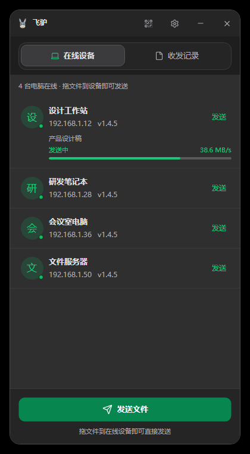
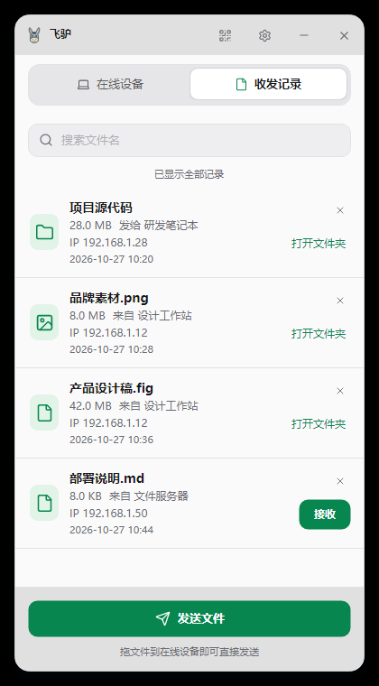
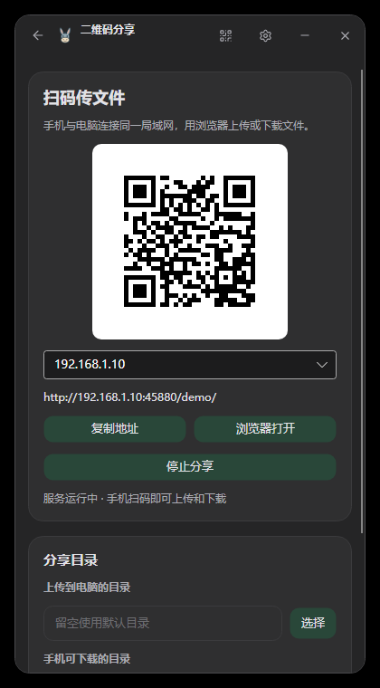
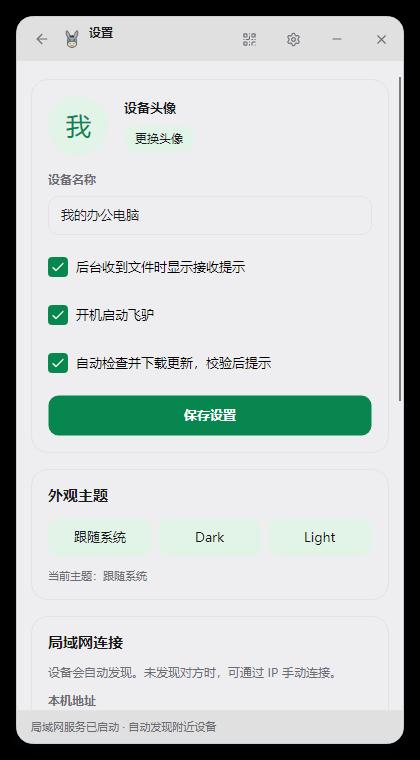
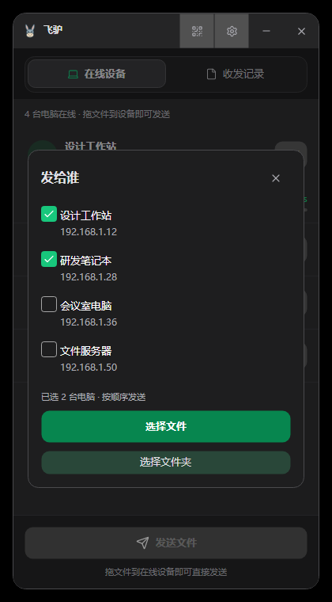
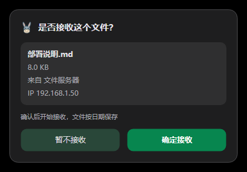

<p align="center">
  
</p>

<h1 align="center">飞驴</h1>

<p align="center"><strong>局域网里，拖一下就传。</strong></p>
<p align="center">电脑互传文件 · 共享本地文件夹 · 手机扫码上传下载</p>

<p align="center">
  <a href="https://github.com/coolqingcheng/feilv/releases/latest"></a>
  <a href="https://github.com/coolqingcheng/feilv/actions/workflows/release.yml"></a>
  
</p>

<p align="center">
  <a href="https://github.com/coolqingcheng/feilv/releases/latest"><strong>下载飞驴</strong></a> ·
  <a href="#界面预览">界面预览</a> ·
  <a href="#快速上手">快速上手</a> ·
  <a href="docs/technical-guide.md">技术文档</a>
</p>

飞驴是一款使用 **C# / Avalonia UI** 开发的局域网文件传输工具。连接同一局域网后自动发现设备，无需注册账号，也无需搭建中心服务器。Windows、macOS 和 Linux 均提供 **Native AOT** 发行包，目标电脑无需安装 .NET。

## 界面预览

| 在线设备 · Dark | 收发记录 · Light |
| :---: | :---: |
|  |  |

<p align="center"><sub>v1.4.5 真实界面，使用演示设备、文件和传输数据。</sub></p>

<details>
<summary><strong>查看更多：二维码分享、主题设置、发送与接收</strong></summary>

| 手机扫码传文件 · Dark | 跟随系统 / Dark / Light |
| :---: | :---: |
|  |  |

| 多选接收设备 | 后台接收确认 |
| :---: | :---: |
|  |  |

</details>

## 能做什么

| 功能 | 使用体验 |
| --- | --- |
| 自动发现设备 | 显示设备名称、头像、IP 和版本号，实时更新上下线状态。 |
| 拖拽传输 | 文件、文件夹直接拖到设备行；也可多选文件和接收电脑，逐台发送。 |
| 保留文件夹结构 | 递归传输文件与子目录，支持空目录，无需打包 ZIP。 |
| 查看进度 | 对应设备行显示进度和实时速度；文件使用流式传输。 |
| 查找收发记录 | 显示文件名、大小、来源、IP 和时间，支持分页滚动、文件名搜索和删除记录。 |
| 轻量接收提示 | 后台来文件只在右下角询问是否接收；完成后可在文件夹中定位文件。 |
| 共享文件夹 | 其他客户端可浏览和下载指定目录中的文件。 |
| 二维码分享 | 手机扫码后用浏览器上传、下载，无需安装客户端；上传与下载目录可分开设置。 |
| 个性化与托盘 | 跟随系统、Dark、Light 三种主题，支持昵称、头像、开机启动和单实例运行。 |
| 应用内更新 | 后台下载并校验，展示更新内容，确认后安装并重启，保留本地数据。 |

## 下载与安装

前往 **[最新正式版](https://github.com/coolqingcheng/feilv/releases/latest)**，按系统和处理器选择一个包：

| 系统 | 处理器 | 选择的发行包 |
| --- | --- | --- |
| Windows | x64 | `win-x64-setup.exe`：单个中文向导安装包 |
| macOS | Apple Silicon | `osx-arm64.tar.gz` |
| macOS | Intel | `osx-x64.tar.gz` |
| Linux | x64 | `linux-x64.tar.gz` |
| Linux | ARM64 | `linux-arm64.tar.gz` |

文件名均以 `feilv-v版本号-` 开头。Windows 双击安装包，按向导选择目录即可，默认安装到当前用户目录，无需管理员权限；目录选择器支持搜索、地址栏和新建文件夹。

macOS / Linux 完整解压后运行 `./feilv`。macOS 当前尚未进行 Apple 公证，首次打开可能需要在系统安全设置中允许；Linux 需要 X11、fontconfig、OpenGL 等桌面系统库，详见[技术文档](docs/technical-guide.md#发布)。

## 快速上手

1. **连接同一局域网**：在两台电脑上启动飞驴，Windows 防火墙提示时允许专用网络访问；在线设备会自动出现。找不到对方时，可在设置中通过 IP 手动连接。
2. **选择接收方并发送**：把文件或文件夹拖到对方设备行，或点击该行的“发送”。底部“发送文件”可勾选多台电脑，依次发送。
3. **确认接收**：对方点击“确定接收”后开始下载。完成后点击“打开文件夹”定位文件；暂不接收的文件也可在收发记录中处理。

**共享目录**：从标题栏菜单进入“共享文件夹”，添加本地目录，或选择在线电脑浏览对方共享。

**手机传文件**：点击标题栏二维码按钮启动分享，手机连接同一局域网后扫码，即可上传、下载。上传与下载目录可以分别设置，留空时使用程序目录下的 `qr-http`；点击“停止分享”后链接失效。

**后台运行**：最小化或关闭主窗口会隐藏到托盘，来文件时显示独立接收提示。从右下角托盘菜单选择“退出”可完全关闭。开机启动首次默认开启，可在设置中关闭。

## 数据与更新

配置、收发记录和文件保存在程序同级目录，文件与图片按天归档：

```text
飞驴.exe / feilv
├─ Data/
│  ├─ config.xml          配置文件
│  ├─ records.dat         收发记录与设备元数据
│  ├─ records.idx         记录索引
│  ├─ identity.pfx        设备证书与私钥
│  └─ Updates/            更新缓存、备份与耗时日志
├─ Files/yyyy-MM-dd/      按天保存的文件与文件夹
├─ Images/yyyy-MM-dd/     按天保存的图片
└─ qr-http/              二维码分享默认目录
```

设置中可以手动检查更新，也可以开启自动检查下载。更新包通过 SHA-256 和大小校验后才提示安装，由用户确认后执行；**更新与卸载均保留本地数据，删除历史记录也会保留对应文件**。备份或迁移时，请一起保存 `Data`、`Files`、`Images` 和需要的 `qr-http` 内容。

适合可信的办公室、家庭等局域网。客户端之间通过双向 TLS 传输；二维码分享使用 HTTP，持有链接的人可访问配置的目录。当前不支持断点续传，记录和文件也不会自动清理。更多说明见[网络与资源](docs/technical-guide.md#网络与资源)、[本地文件](docs/technical-guide.md#本地文件)和[软件更新](docs/technical-guide.md#软件更新)。

## 开发

安装 [.NET 10 SDK](https://dotnet.microsoft.com/download/dotnet/10.0)，在仓库根目录执行：

```powershell
dotnet build LanChat.slnx
dotnet run --project src/LanChat.Desktop
dotnet run --project tests/LanChat.IntegrationTests
```

代码按 **Core / Infrastructure / Desktop** 三层组织：Core 定义模型与服务契约，Infrastructure 实现网络、文件存储和更新，Desktop 使用强类型 XAML 与 MVVM 组织界面。依赖方向为 Desktop → Core + Infrastructure，Infrastructure → Core。

| 技术 | 用途 |
| --- | --- |
| .NET 10 / Native AOT | 原生发布，使用异步 API 与有界缓冲区 |
| Avalonia 11 / CommunityToolkit.Mvvm | 跨平台界面、MVVM 属性与命令源生成 |
| UDP / TCP + TLS | 局域网自动发现、身份校验与文件传输 |
| 文件索引 / XML | 本地记录与配置，不依赖数据库 |
| QRCoder / Lucide SVG | 二维码与矢量图标 |

构建、验证、资源管理、安装器与发布流程见[技术与维护指南](docs/technical-guide.md)。GitHub Actions 为五个平台构建 AOT 包，通过检查后统一发布；Windows 使用 Inno Setup 制作单个 EXE 安装包。

遇到问题或有建议，欢迎[提交 Issue](https://github.com/coolqingcheng/feilv/issues)。
